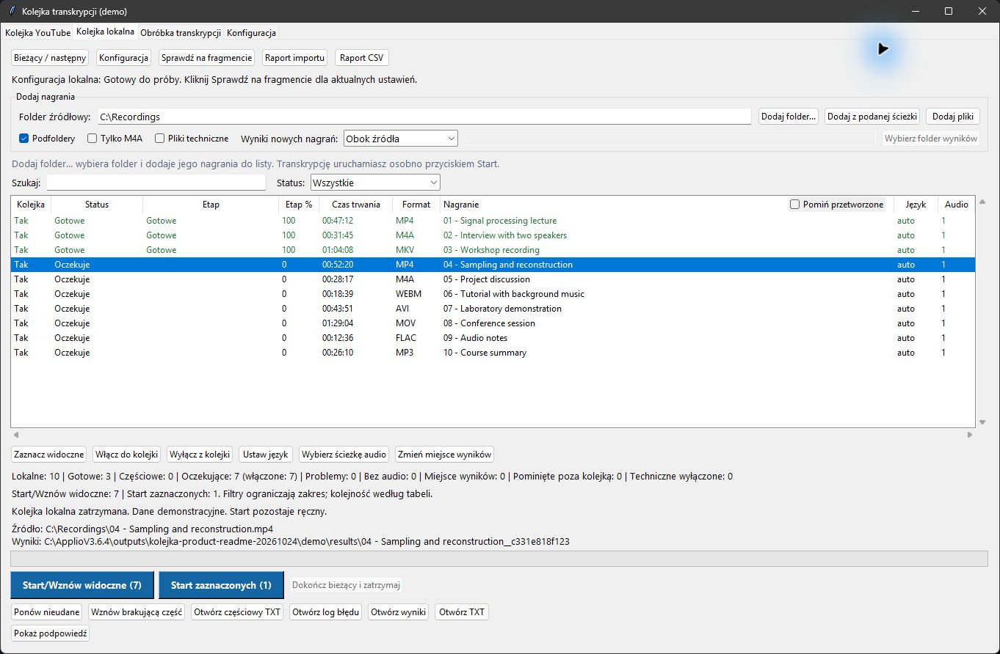
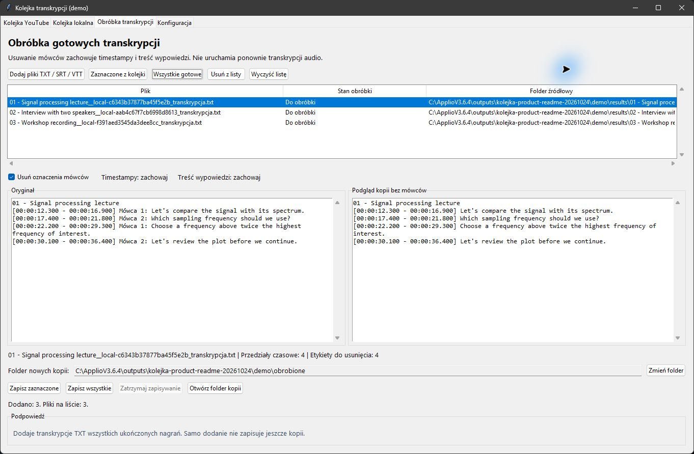
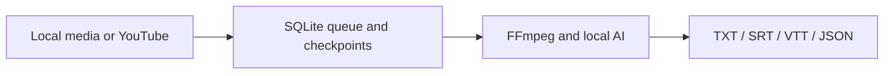

# Kolejka transkrypcji

**Turn recordings into timestamped transcripts and subtitles on your Windows PC.**

Queue local audio, video or a YouTube catalog, let it process, then pick up where you left off. Speech recognition runs locally with Whisper and OpenVINO.

[**Download source ZIP**](https://github.com/haribo841/kolejka-transkrypcji/archive/refs/heads/master.zip) · [Quick start](#quick-start) · [Documentation](docs/README.md) · [Report an issue](https://github.com/haribo841/kolejka-transkrypcji/issues)

[](https://github.com/haribo841/kolejka-transkrypcji/actions/workflows/python.yml)
[](https://sonarcloud.io/dashboard?id=haribo841_WebApplication1)
[](LICENSE)



*Actual application with demonstration data. The interface is in Polish; this README and the getting-started guide are in English.*

## Quick start

**Platform:** Windows 10 or 11. The basic setup needs Python 3.13 and FFmpeg/FFprobe. Python 3.12 is needed for optional speaker labels and vocal separation; Node.js 22 is used for YouTube. See [prerequisites and installation](docs/GETTING_STARTED.md#prerequisites).

1. **Download** the source ZIP above and extract it, or clone this repository. The current distribution is source code, not a standalone installer.
2. **Install and open** the local queue from PowerShell in the extracted folder:

   ```powershell
   .\Instaluj-zaleznosci.ps1 -WithoutSpeakers
   .\Uruchom-kolejke-lokalna.vbs
   ```

3. **Configure once:** open **Konfiguracja → Kreator krok po kroku**. Download Whisper; turn off UVR and speaker labels for the simplest first run. Complete the sample test on up to 60 seconds of speech.
4. **Add recordings:** use **Dodaj pliki** or **Dodaj folder...**, choose where to save results, then click **Start/Wznów widoczne (N)**. To stop later, choose **Dokończ bieżący i zatrzymaj**; the current recording finishes and the rest wait for your next Start.

[Step-by-step setup, optional models and troubleshooting →](docs/GETTING_STARTED.md)

## What you can do

- **Process a recording archive.** Import local files or folders with subfolders, or a YouTube XLSX catalog. Supported formats include WAV, MP3, M4A, FLAC, OGG/Opus, MP4, MKV, WebM, MOV and AVI.
- **Resume without starting over.** SQLite tracks progress and verified checkpoints preserve completed blocks. Reimporting identical local content does not create another job.
- **Choose your session.** Search, filter and sort either queue, then process its visible recordings or a selected subset. The session keeps that order even if you change the view.
- **Export useful text.** Every recording gets its own TXT, SRT, VTT and JSON results, with timestamps and optional speaker labels. Local results can live beside the source or in a chosen folder.
- **Handle difficult audio locally.** Optionally separate vocals with UVR and distinguish speakers with pyannote Community-1. Model setup is separate from starting the queue.
- **Clean up transcripts.** Remove speaker labels from existing TXT/SRT/VTT files while preserving timestamps, spoken text and originals. No audio inference is repeated.

Local inference stays on your PC. Initial model downloads and YouTube access require an internet connection. Audacity is not required.

## Example result

An illustrative TXT export looks like this; subtitle and JSON files accompany it:

```text
[00:00:12.300 - 00:00:16.900] Mówca 1: Let's compare the signal with its spectrum.
[00:00:17.400 - 00:00:21.800] Mówca 2: Which sampling frequency should we use?
```

[Open the example TXT](docs/examples/demo-transcript.txt) · [Open the example SRT](docs/examples/demo-transcript.srt)

<details>
<summary>See transcript editing: keep the times and text, remove the speaker labels</summary>



The preview uses the illustrative example linked above. Saving creates a separate copy.

</details>

## Built with

| Component | Purpose |
| --- | --- |
| Python · Tkinter/ttk | Windows desktop UI and a separate queue worker |
| SQLite · SHA-256 | Durable queue state, content identity and checkpoint verification |
| FFmpeg/FFprobe · yt-dlp | Media decoding, audio track discovery and YouTube downloads |
| OpenVINO GenAI · Whisper large-v3-turbo | Local speech recognition and word timestamps; CPU by default |
| pyannote Community-1 · audio-separator/UVR | Optional speaker diarization and vocal separation |



For implementation details, see [architecture and recovery guarantees](docs/ARCHITECTURE.md). The [Windows CI workflow](.github/workflows/python.yml) checks locked dependencies, source compilation and offline tests covering queues, media decoding, GUI behavior and exports.

## Documentation and support

[Documentation index](docs/README.md) · [Architecture](docs/ARCHITECTURE.md) · [Detailed user guide (Polish)](KOLEJKA.md) · [Issues](https://github.com/haribo841/kolejka-transkrypcji/issues) · [MIT license](LICENSE)

The MIT license covers this application; model weights and dependencies retain their own licenses and access conditions. [Previous README, preserved verbatim](docs/archive/README-kolejka-2026-10-24.md).
