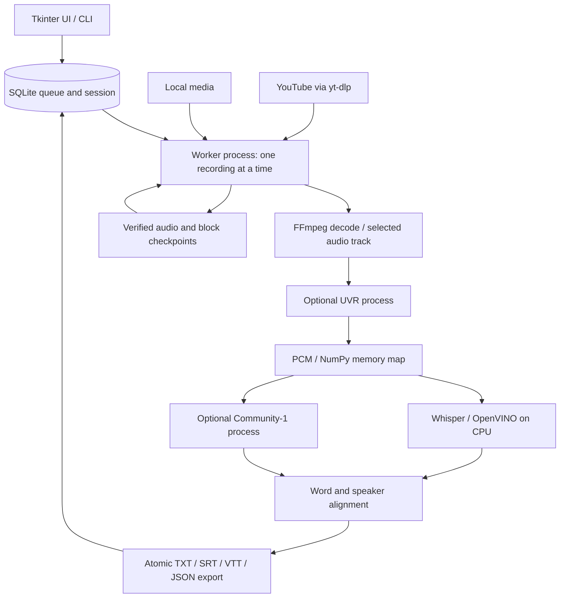

# Architecture and reliability

[Product page](../README.md) · [Documentation index](README.md) · [Getting started](GETTING_STARTED.md)

## Design

Kolejka transkrypcji separates the Windows UI from a persistent, single-worker queue. The UI chooses work and displays snapshots; a separate process owns media preparation, inference and verified exports. Closing the UI does not terminate that worker.



The UVR node is bypassed when separation is disabled; diarization is optional. Models are local after setup. Separate environments keep the main OpenVINO stack apart from the PyTorch-based optional stages. This adds installation work, but avoids requiring every user to load every model into one Python environment.

## Source map

| Area | Main source |
| --- | --- |
| Entry points and launchers | [`kolejka.py`](../kolejka.py), [`transcribe.py`](../transcribe.py), VBS launchers |
| UI and table behavior | [`batch/gui.py`](../batch/gui.py), [`local_tab.py`](../batch/local_tab.py), [`table_view.py`](../batch/table_view.py) |
| Setup and readiness | [`config_wizard.py`](../batch/config_wizard.py), [`readiness.py`](../batch/readiness.py), [`setup_model.py`](../batch/setup_model.py) |
| Queue and session state | [`store.py`](../batch/store.py), [`worker.py`](../batch/worker.py) |
| Import and media handling | [`importers.py`](../batch/importers.py), [`media.py`](../batch/media.py), [`audio_recovery.py`](../batch/audio_recovery.py) |
| Speech and speakers | [`asr.py`](../batch/asr.py), [`diarization.py`](../batch/diarization.py), [`speakers.py`](../batch/speakers.py) |
| Vocal separation and timing | [`uvr_recovery.py`](../batch/uvr_recovery.py), [`uvr_timeline.py`](../batch/uvr_timeline.py) |
| Exports and transcript tools | [`exporter.py`](../batch/exporter.py), [`result_paths.py`](../batch/result_paths.py), [`transcript_edit.py`](../batch/transcript_edit.py) |

## Queue identity and session order

YouTube jobs use the video ID. Local jobs use SHA-256 content identity and retain path, size and modification-time metadata. Identical content imported from another path resolves to an existing job; reimport does not reset a finished result. An inaccessible or changed file is not assumed to be the original content.

Both tables sort records before rendering. Starting a visible or selected session writes an ordered list of job IDs to SQLite. The worker uses that snapshot rather than the live table, while disabled jobs remain excluded. New imports and later changes to sorting or filters wait for another Start.

The database uses transactions, WAL and full synchronization. An operating-system lock allows only one worker for a queue directory. GUI reads use a bounded read-only snapshot; if SQLite is briefly locked, the previous view remains visible and a refresh is scheduled. Heartbeat lock failures are logged and retried.

## Bounded audio and checkpoints

FFmpeg prepares audio on the selected track's timeline. Long audio is read through a PCM memory map and NumPy arrays, rather than a Python list containing every sample.

Default processing blocks are:

| Stage | Block | Context |
| --- | --- | --- |
| Whisper ASR | 10 minutes | 5 seconds |
| Community-1 diarization | 30 minutes | 10 seconds |
| UVR | 5 minutes | 3 seconds |

Completed blocks are checkpointed with content/configuration identifiers and checksums. On resume, verified work is reused. Appending a recovered tail does not invalidate every unchanged earlier audio block. Changed model, language, track or relevant block settings invalidate incompatible work.

UVR compares its output against prepared input samples. It keeps a verified prefix, then makes one recovery pass over the missing tail in 60-second blocks. Missing model output is not stretched or disguised as silence. Confirmed source audio ending before the video can be padded with silence to preserve the video clock.

Diarization assigns local speakers within blocks, then uses embeddings and the model's threshold to associate speakers across the recording. Different speakers from the same block cannot be merged. Words are assigned by temporal overlap. Labels restart for each recording; uncertain assignments and overlapping speech remain represented in JSON. This is a heuristic association, not speaker identity verification.

## Completion means a verified outcome

| Outcome | Meaning and next step |
| --- | --- |
| Done | All required exports have been atomically written and checked |
| Done with recovered-source warning | Available recovered audio has been processed; JSON records `source_complete=false`, retained work and no automatic retry recommendation |
| No recognized speech / empty source | A valid empty result is exported; malformed input is not treated as successful silence |
| Partial | A usable prefix is exported with partial markers; audio and checkpoints remain for a later attempt |
| Skipped | A permanently unreadable or confirmed technical source is excluded from normal processing, with its reason retained |
| Retryable failure | File access or a repairable processing problem remains visible for diagnosis or retry |
| Session pause | User stop, a shared model/resource problem or a YouTube rate limit prevents continuing the session |

A recording-specific error or partial outcome does not block subsequent jobs. A partial job is attempted at most once per session. Recovered-source completion does not certify that every original sample survived corruption; processing completeness and source completeness are distinct fields.

Each recording owns its result directory. Exports contain a stable identity in their names; an occupied output name receives a new version. The completion manifest records checksums for the four required formats and retained audio. A job is marked Done only after verification, including recovery after a crash between exporting and updating SQLite. Cleanup removes only owned intermediate data and preserves originals; recovered/partial work can be retained deliberately.

## Limits and tradeoffs

- A single worker favors predictable resource use and resumability over maximum batch throughput.
- Source format support depends on FFmpeg's actual ability to decode the selected track.
- Whisper defaults to CPU; GPU suitability for optional stages is checked at execution, not inferred from device enumeration.
- Word times, automatic languages, speaker labels and cross-block speaker grouping need human review. Music and simultaneous speech remain difficult.
- YouTube is an external dependency. A browser session does not guarantee that downloading will be allowed.
- Model weights and environments are installed locally and are not bundled in the Git repository or covered solely by the application's MIT license.

## Development checks

Use the pinned dependencies and FFmpeg integration tools:

```powershell
.\.venv\Scripts\python.exe -m pip install -r requirements-batch.lock.txt -r requirements-test.lock.txt
.\.venv\Scripts\python.exe -m pip check
.\.venv\Scripts\python.exe scripts/check_sonar_scope.py
.\.venv\Scripts\python.exe -m unittest discover -v
```

The [Windows CI workflow](../.github/workflows/python.yml) pins Python 3.13 and FFmpeg 8.0.1, checks the exact commit's Sonar source/test classification, compiles sources and runs offline tests. These cover import deduplication, session order, SQLite lock behavior, GUI flows, real FFmpeg decoding, output ownership and recovery. Model calls and YouTube responses use controlled doubles in this suite. Real model trials are separate; offline test success is not proof of live model quality or YouTube availability.

[Sonar configuration](../.sonarcloud.properties) lists tests separately while retaining the production scope. The pre-push guard can be enabled with `git config --local core.hooksPath .githooks`; check any existing hook configuration first. If needed, set `git config --local kolejka.qualityPython 'C:/Path/To/python.exe'`. The guard validates the exact Git trees being pushed. It checks classification, not the full Quality Gate; CI and remote Sonar results must be assessed separately.
